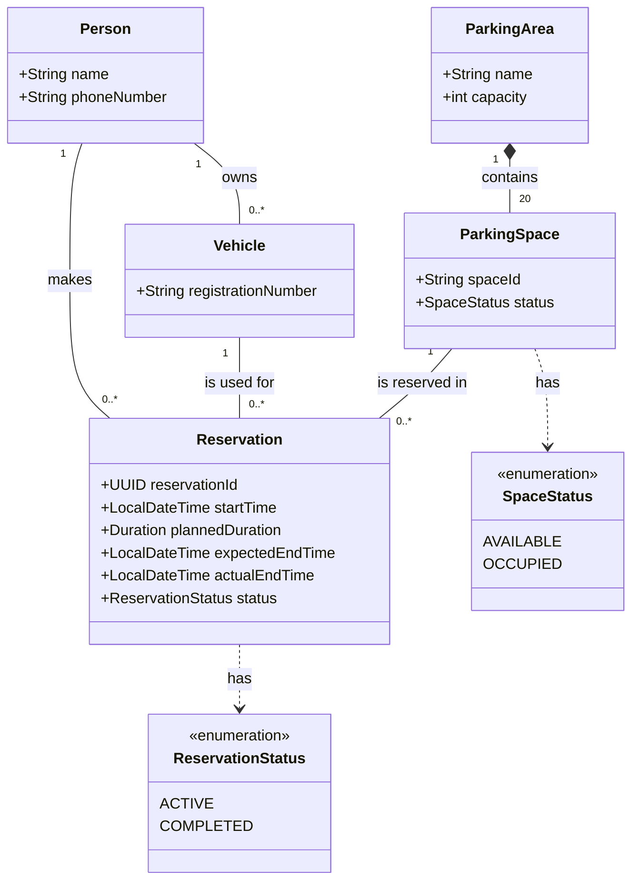

# Parking Reservation App

A Java application starter for managing parking reservations at the Lexicon building.

## Run locally

Install JDK 25 (LTS) and Apache Maven 3.8 or newer. Confirm Maven is using JDK 25:

```bash
java -version
mvn -version
```

If needed, set `JAVA_HOME` to your JDK 25 installation before starting Maven. Replace `/path/to/jdk-25` with the JDK installation directory on your computer:

```bash
export JAVA_HOME="/path/to/jdk-25"
export PATH="$JAVA_HOME/bin:$PATH"
```

Start the web application:

```bash
mvn spring-boot:run
```

Open [http://localhost:8080](http://localhost:8080) in a browser. Stop the app with `Ctrl+C`.

## Build and test

```bash
mvn clean verify
```

## Storage approach

For this learning project, data storage will initially use in-memory Java collections rather than a database. Keep shared repository instances alive for the duration of the application so reservations and parking-space availability stay consistent while it is running. Data is cleared when the application stops. Database persistence can be added later as a separate learning step.

## Project structure

```text
src/
├── main/java/se/lexicon/parking/  # Application, service, model, storage, and web controller
├── main/resources/
│   ├── templates/                 # Thymeleaf pages
│   └── static/                    # CSS and other static assets
└── test/java/se/lexicon/parking/  # Unit and MVC tests
```

Domain concepts are documented in [DOMAIN_CONCEPTS.md](DOMAIN_CONCEPTS.md), with the main class model in [UML_CLASS_DIAGRAM.md](UML_CLASS_DIAGRAM.md).
The team task breakdown is in [IMPLEMENTATION_TASKS.md](IMPLEMENTATION_TASKS.md).

## Learning resource

The simplified three-class UML diagram is kept separate as a [learning model](docs/learning/SIMPLIFIED_UML_CLASS_DIAGRAM.md).

## Class diagram


