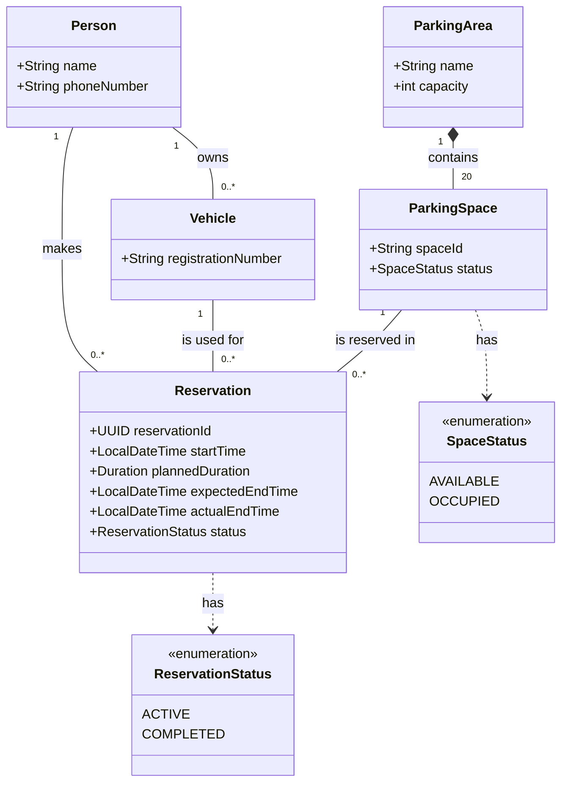

# Parking Reservation App

A Java application starter for managing parking reservations at the Lexicon building.

## Requirements

- JDK 25 (LTS)
- Apache Maven 3.8 or newer

Make sure `java -version` and `mvn -version` work in your terminal. On WSL, install JDK 25 inside the WSL environment and set `JAVA_HOME` to its installation directory if needed.

## Build and test

```bash
mvn clean verify
```

## Run

```bash
mvn exec:java
```

## Project structure

```text
src/
├── main/java/se/lexicon/parking/  # Application source
└── test/java/se/lexicon/parking/  # JUnit tests
```

Domain concepts are documented in [DOMAIN_CONCEPTS.md](DOMAIN_CONCEPTS.md), with the class model in [UML_CLASS_DIAGRAM.md](UML_CLASS_DIAGRAM.md).

## Class diagram


