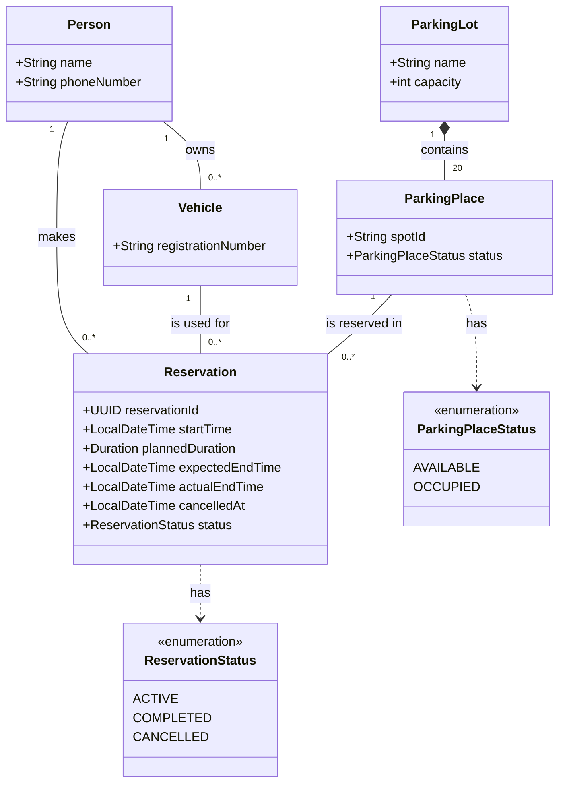

# Parking Reservation System — UML Class Diagram

## Multiplicities and domain constraints

- The parking lot contains exactly 20 parking places.
- Each vehicle has one registered person; a person may register zero or more vehicles.
- Each reservation belongs to exactly one person, uses exactly one vehicle, and reserves exactly one parking place. Each of those can be associated with multiple reservations over time.
- A parking place may have no reservations or many reservations over time, but no more than one active reservation at any moment.
- `expectedEndTime` is calculated from `startTime` plus `plannedDuration`.
- When the system next evaluates reservations at or after `expectedEndTime`, it completes the reservation, sets `actualEndTime` to `expectedEndTime`, and makes the place available.
- A person may complete a reservation early; this records the actual checkout time, changes its status to `COMPLETED`, and makes the place available.
- Cancelling an active unpaid reservation sets `cancelledAt`, changes its status to `CANCELLED`, and makes the place available. A completed or cancelled reservation cannot be cancelled again.
- `ParkingPlace.status` is `OCCUPIED` while it has an active reservation; it becomes `AVAILABLE` when the reservation is completed, cancelled, or processed as complete after its expected end time.
