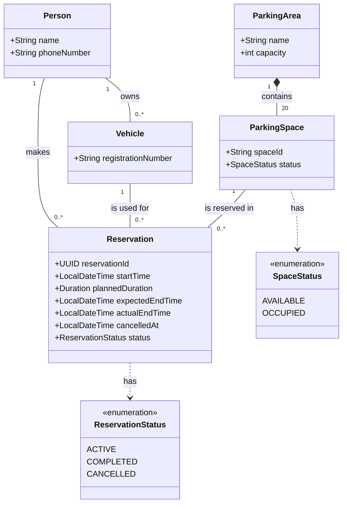

# Parking Reservation System — UML Class Diagram

## Multiplicities and domain constraints

- The parking area contains exactly 20 parking spaces.
- Each vehicle has one registered person; a person may register zero or more vehicles.
- Each reservation belongs to exactly one person, uses exactly one vehicle, and reserves exactly one parking space. Each of those can be associated with multiple reservations over time.
- A parking space may have no reservations or many reservations over time, but no more than one active reservation at any moment.
- `expectedEndTime` is calculated from `startTime` plus `plannedDuration`.
- `actualEndTime` is set when the reservation is completed. Completing a reservation changes its status to `COMPLETED` and makes its space available.
- Cancelling an active unpaid reservation sets `cancelledAt`, changes its status to `CANCELLED`, and makes its space available. A completed or cancelled reservation cannot be cancelled again.
- `ParkingSpace.status` is `OCCUPIED` while it has an active reservation; otherwise it is `AVAILABLE`.
