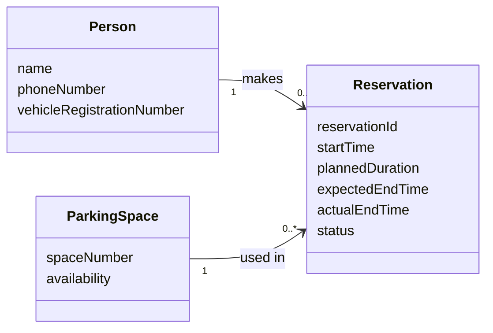
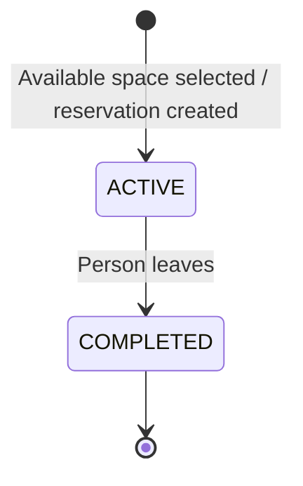
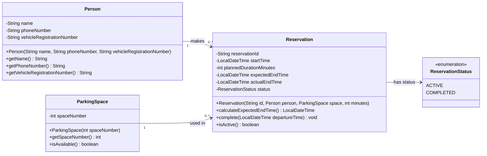

# Parking App Workshop — My Domain Model and UML Class Diagram

**Workshop:** Lexicon Parking App (Växjö)  
**Prepared by:** Anas  
**Status:** Individual proposal — for discussion with the other five team members  
**Scope:** Challenge 1 (Domain Model) and Challenge 2 (UML Class Diagram)

---

## 1. Understanding the Scenario

The Lexicon building in Växjö has **20 parking spaces** used by students, staff, and visitors. A person provides a name, phone number, and vehicle registration number. The person can see which spaces are free, select an available space, and specify how long they plan to park.

The system must create a uniquely identified reservation, record when it starts, calculate the expected end time, and treat the selected space as occupied. When the person leaves, the reservation is completed and the space becomes available again.

I will first model **what exists and how it connects**, then translate the agreed concepts into a UML design. I am not implementing Challenge 3 (optional code) in this document.

## 2. Challenge 1 — Domain Model

### 2.1 Identify the domain concepts

| Concept found in the scenario | My classification | Reason |
|---|---|---|
| Person | **Entity** | The same person may make reservations over time. |
| Parking space | **Entity** | Each of the 20 physical spaces has its own identity and changes availability. |
| Reservation | **Entity** | Each reservation has a unique identity, start time, and lifecycle. |
| Name | Attribute of Person | Describes the person; it has no independent lifecycle. |
| Phone number | Attribute of Person | Contact information. |
| Vehicle registration number | Attribute of Person **in this simple model** | The scenario asks for one registration number per person; it does not require independent vehicle management. |
| Space number | Attribute of ParkingSpace | Identifies a particular space. |
| Start time, planned duration, expected end time | Attributes of Reservation | Describe the reservation period. |
| Reservation status | Category / attribute of Reservation | Distinguishes an active reservation from a completed one. |
| Parking area / Lexicon building | Context | One fixed site is given; the scenario does not require managing multiple car parks. |

**My core entities:** `Person`, `ParkingSpace`, and `Reservation`.

**My category:** `ReservationStatus`, with the proposed values `ACTIVE` and `COMPLETED`.

### 2.2 Relationship sentences

1. **A person makes reservations.** One person may make zero or many reservations over time; each reservation belongs to exactly one person.
2. **A parking space is used by reservations.** One parking space may appear in zero or many reservations over time; each reservation refers to exactly one parking space.
3. **A reservation has a status.** It is active while the person is parked and completed after the person leaves. The status is a value of the reservation, not an independently managed entity.

**Important distinction:** `0..*` reservations per parking space means **over its entire history**. It does *not* mean that several people may occupy the same space simultaneously. At most **one active reservation** may use a space at any moment.

### 2.3 Domain model diagram

This first diagram is intentionally conceptual: names, important attributes, relationships, and multiplicities only. It has **no code methods, visibility symbols, or UML inheritance**.

**How to read the diagram:** Every reservation has **one person** and **one parking space**. Both people and spaces can be associated with **many historical reservations**, even though the same space cannot have two active reservations at once. `availability` is shown as a domain concept; I propose calculating it from active reservations rather than storing a second, potentially inconsistent status.

### 2.4 Business rules

These rules are based on the scenario unless marked as a proposed interpretation.

| # | Rule | Source / interpretation |
|---|---|---|
| 1 | The parking area contains **20 spaces**. | Explicit scenario requirement. |
| 2 | A person provides a **name, phone number, and vehicle registration number**. | Explicit scenario requirement. |
| 3 | A person selects an **available** space and provides a **planned parking duration**. | Explicit scenario requirement. |
| 4 | Each reservation has a **unique reservation ID**. | Explicit scenario requirement. |
| 5 | Each reservation records a **start time** and an **expected end time**. | Explicit scenario requirement. |
| 6 | **Expected end = start time + planned duration.** | Direct interpretation of the scenario. |
| 7 | An active reservation makes its space **unavailable**. | Explicit scenario requirement. |
| 8 | Completing a reservation makes the space **available again**. | Explicit scenario requirement. |
| 9 | A space may have **at most one active reservation at a time**. | Necessary interpretation to prevent double-booking. |
| 10 | A reservation follows the states `ACTIVE` → `COMPLETED`. | Proposed minimal status model to represent the stated lifecycle. |
| 11 | The planned end time **does not automatically complete** a reservation. | My interpretation: the scenario says completion occurs *when the person leaves*. |

### 2.5 Reservation lifecycle

A space is **occupied** while its associated reservation is `ACTIVE`. Completing that reservation removes the active occupancy. Past completed reservations remain useful as reservation history.

---

## 3. Challenge 2 — UML Class Diagram

Now I translate the domain model into classes with **typed private fields**, **public operations**, **precise relationships**, and **multiplicities**. Since our workshop uses Java, the types and operations follow Java conventions, but this is still a design diagram — **not Java code**.

### 3.1 Responsibilities of each class

| Class | Responsibility |
|---|---|
| `Person` | Holds the registration details required by the scenario. |
| `ParkingSpace` | Identifies a physical parking space and answers whether it can be reserved. |
| `Reservation` | Connects one person to one space; records time, calculates the expected end, and manages completion. |
| `ReservationStatus` | Restricts the possible reservation statuses to `ACTIVE` and `COMPLETED`. |

### 3.2 UML relationships and multiplicities

| Relationship | Multiplicity | Explanation |
|---|---|---|
| `Person` → `Reservation` | `1` ↔ `0..*` | A reservation is made by one person; a person can make many reservations over time. |
| `ParkingSpace` → `Reservation` | `1` ↔ `0..*` | A reservation concerns one space; a space can appear in many historical reservations. |
| `Reservation` → `ReservationStatus` | Typed status value | The enumeration is the type of `Reservation.status`, **not** a separate business entity. |

I use **associations** rather than composition for the person and space relationships. A person and a parking space exist independently of any particular reservation. A completed reservation can remain in history without controlling the lifecycle of either of them.

### 3.3 Design decisions

**Why is there no `Vehicle` class?** The workshop only asks for a vehicle registration number. I include it in `Person` for simplicity. If a person can register multiple vehicles, or the system must preserve which vehicle was used in each historical reservation, I would introduce a separate `Vehicle` entity or associate a vehicle registration with each reservation. That is a question for the team.

**Why no `Student`, `Staff`, or `Visitor` subclasses?** The scenario says these groups use the spaces, but it does not give them different permissions or behaviors. Subclasses would introduce complexity without a stated requirement.

**Why no `ParkingLot` class?** We have one fixed parking area with 20 spaces. If the system expands to multiple locations, a `ParkingLot` class with a `1` → `1..*` relationship to `ParkingSpace` would make sense.

**Why not save a separate `occupied` boolean?** The reservation already tells us whether a space is occupied. Keeping a second boolean risks contradictory data. `ParkingSpace.isAvailable()` should answer **true only when no active reservation exists** for that space. This still fulfills the scenario's requirement to mark a selected space as occupied.

**Why keep actual end time?** The expected end time is calculated when parking begins; the actual departure time is only known when the person leaves. The actual end time is empty (`null`) until completion.

**Why does `Reservation` have an ID?** The scenario explicitly requires a unique identifier. I represent it as a `String`; the team could later choose a UUID or another unique identifier strategy.

**Why are there no booking/payment/cancellation classes?** The workshop does not require advance booking, fees, payments, cancellations, or notifications. These should not be assumed in the initial model.

### 3.4 Example that tests the model

1. Space **7** is available.
2. A person registers with their name, phone number, and vehicle registration number.
3. They select space **7** and choose **90 minutes**.
4. A reservation is created at, for example, **10:00**, with a unique ID and expected end time **11:30**.
5. Its status becomes `ACTIVE`; space **7** is now unavailable for any other active reservation.
6. The person leaves at **11:15**, and the reservation is marked `COMPLETED` with that actual end time.
7. Space **7** becomes available again, while the completed reservation stays in history.

This is an **illustrative test case**, not additional information provided by the workshop.

---

## 4. My Proposed Conclusion

For the current workshop, I recommend starting with **three entities: `Person`, `ParkingSpace`, and `Reservation`**, plus a `ReservationStatus` category in the UML model. This represents all required actions without introducing unsupported features. The essential rule is that **each reservation uses exactly one space, and each space may have only one active reservation at a time**.

I am open to revising this model after hearing the other five members' reasoning. Our objective is to agree on the simplest model that accurately describes the scenario.

---

### Reference material

- `OOP_Workshop_ParkingApp.md` — scenario and workshop challenges.
- `OOP_Domain_Modeling_Guide.md` — domain modeling approach and transition to UML.
