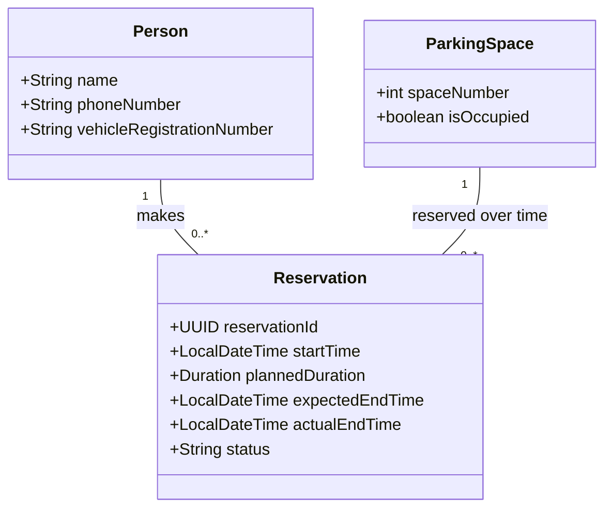

# Learning UML: Simplified Parking Reservation Class Diagram

This is a learning model kept separate from the main UML class diagram. The parking area is represented by the constraint that it contains 20 parking spaces, so the simplified model needs only three classes.

## Requirements represented

- A person registers with a name, phone number, and vehicle registration number.
- The parking area has 20 numbered spaces. `isOccupied` indicates whether a space is available or occupied.
- Each reservation belongs to exactly one person and one parking space; each can be associated with multiple reservations over time.
- Each reservation has a unique identifier, start time, planned duration, and calculated expected end time. The actual end time is recorded when the person leaves.
- A parking space can have at most one active reservation at a time. Completing a reservation makes the space available again.
